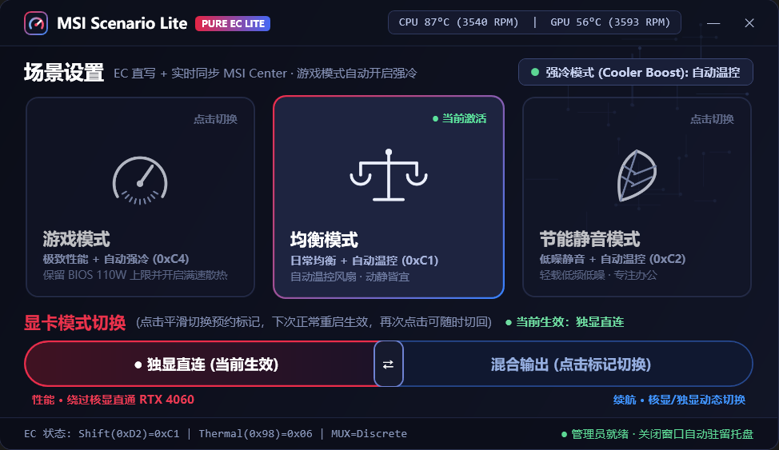

# MSI Scenario Lite

> 一个约 65 KB 的原生 Windows 小工具，替代臃肿的 MSI Center：只保留**使用场景切换**、**强冷风扇开关**与**显卡模式（MUX）切换**，直接与主板 EC 芯片通信，不改写 BIOS 功耗墙、不装后台服务、不驻留 AI 引擎。



**English TL;DR** — A tiny native WPF (C# / .NET Framework 4.x) replacement for MSI Center's *User Scenario* + *GPU Switch* panels. It talks straight to the MSI EC through the inbox `root\WMI` ACPI interface (`WMIACPI`), never touches `PL1/PL2` power-limit registers, and stages GPU MUX changes for the next boot instead of forcing an immediate reboot. Reverse-engineered from MSI Center's own managed assemblies; see [`docs/EC-REGISTER-REFERENCE.md`](docs/EC-REGISTER-REFERENCE.md).

---

## 为什么会有这个项目

MSI Center 做三件很小的事，却要付出很大代价：

| 问题 | 后果 |
| :--- | :--- |
| 切换场景时会一并改写 `EC 0x50 / 0x51`（PL1 / PL2）并强推软件风扇表（`EC 0xD4 = 0x8D`） | BIOS 里调好的 `PBO Limits` 被微星预设的 `45 W / 65 W` 覆盖，性能莫名掉回去 |
| 开机时 `MSI Foundation Service` 会再写一次 EC | 每次重启后功耗墙都可能被重置 |
| 常驻十余个进程（AI Engine、Gaming Mode、TrueColor、VoiceCommand…） | 内存与 WMI 轮询开销、后台互相抢状态 |
| 切换显卡模式点「确定」即 `shutdown /r /t 0` | 手头工作被强制中断 |

本项目只保留必要的寄存器写入，其余一律不做。

---

## 功能

- **三档使用场景**：游戏模式（`EC 0xD2 = 0xC4`）、均衡模式（`0xC1`）、节能静音模式（`0xC2`）
  - 切到游戏模式时**自动开启强冷**（`EC 0x98 |= 0x80`），与 MSI Center 的 Extreme 预设一致
  - 切回均衡 / 静音时自动交还 EC 原生温度曲线（`EC 0xD4` bit 7 清零）
  - **支持可选「启动恢复上次场景」**：主板 EC 在每次重启后默认将 `0xD2` 恢复为均衡模式（`0xC1`）；面板右上角与托盘菜单提供一键开关，开启后每次启动自动恢复上次保存的场景
  - **绝不写 `0x50 / 0x51`**，BIOS 里的 `PPT / TDC / EDC` 原样保留
- **强冷开关**：可脱离场景单独开关
- **显卡模式切换（MUX）**：通过 `EC 0xD1` 预约切换并实时回读状态位（`0x06` = 独显直连、`0x02` = 混合输出），**下次重启自动生效**；再次点击原模式可随时取消预约，**任何情况下都不会强制重启**
- **系统托盘常驻**：双击呼出面板，右键可直接切换模式 / 强冷 / 显卡模式
- **实时遥测**：CPU / GPU 温度与风扇转速（直接读 EC，不依赖第三方驱动）
- **与原版 MSI Center 状态同步**：可选；即使已卸载也不会报错（自动降级为独立模式）
- **一键禁用 / 恢复原版后台服务**：`Disable-MSICenter.bat` / `Restore-MSICenter.bat`

---

## 系统要求

| 项目 | 要求 |
| :--- | :--- |
| 系统 | Windows 10 / 11 x64 |
| 运行时 | .NET Framework 4.7.2 或更高 —— **Windows 10 1903+ / Windows 11 已内置（4.8 / 4.8.1），无需下载** |
| 依赖 | 本机已安装 **MSI Center**（仅用于提取 `MSIWMIACPI2.dll`；安装好后可按下方说明停用它的后台服务） |
| 编译器 | 同上：`%WINDIR%\Microsoft.NET\Framework64\v4.0.30319\csc.exe` 随系统自带，**不需要 Visual Studio、.NET SDK 或任何额外安装** |
| 硬件 | 支持 MSI `WMIACPI 2.8` 的微星笔记本（本项目在 MSI Alpha 17 C7VF 上实测；其他机型需自行验证寄存器语义） |
| 权限 | **管理员**（已内嵌 `requireAdministrator` 清单，双击即提权） |

> 仅在极端精简的系统镜像（例如被裁掉了 .NET Framework 的 LTSC 定制版）上才需要手动安装：[.NET Framework 4.8 下载页](https://dotnet.microsoft.com/download/dotnet-framework/net48)。常规 Win10/Win11 无需任何下载。

> ⚠️ 仅在**微星笔记本**上工作。EC 寄存器语义因机型 / EC 固件版本而异，请先只读验证，再执行写操作。

---

## 快速开始

1. 确认本机已安装 **MSI Center**（只需要它目录里的 `MSIWMIACPI2.dll`）。
2. 解压发布包（或 `git clone` 仓库）。
3. 双击根目录的 **`Start.bat`**，在 UAC 弹窗中选择“是”。

> 如果 Windows 弹出“Windows 已保护你的电脑”等安全提示，点“更多信息 → 仍要运行”即可。

`Start.bat` 会把所有准备工作一次做完，全程不需要命令行：

| 步骤 | 自动执行的内容 |
| :--- | :--- |
| 1 | 清理旧版本遗留的无关文件（`ResetUEFIVariable.exe`、`UEFIVaribleDll.dll`） |
| 2 | 从本机 MSI Center 复制唯一依赖 `MSIWMIACPI2.dll`（已存在则跳过） |
| 3 | 用系统自带 `csc.exe` 编译（`MsiScenarioLite.exe` 不存在或源码有改动时） |
| 4 | 启动程序；若程序已在托盘运行，则直接切回前台 |

> 之后日常启动直接双击 `MsiScenarioLite.exe` 即可。运行目录需包含 `Assets\` 与 `MSIWMIACPI2.dll`（即仓库根目录本身）。

### 从旧版本升级

把新包直接解压覆盖到原目录，再双击一次 `Start.bat` 即可。脚本会删除旧版本残留的两个无关依赖文件，并在源码 / 依赖有变化时自动重新编译，不需要手动清理或命令行操作。

### 手动构建（开发者）

```powershell
powershell -ExecutionPolicy Bypass -File .\tools\Prepare-Dependencies.ps1
powershell -ExecutionPolicy Bypass -File .\build.ps1
```

`build.ps1` 需要的唯一第三方文件是 `MSIWMIACPI2.dll`；`Prepare-Dependencies.ps1` 会从本机 MSI Center 自动查找并复制它（不下载任何内容），同时清理旧版残留。

### 编码约定（改脚本前必读）

| 文件类型 | 编码 | 原因 |
| :--- | :--- | :--- |
| `*.bat` | **纯 ASCII**（不得含中文） | `cmd.exe` 按**控制台 OEM 代码页**解析批处理文件，UTF-8 中文会被解成乱码并被当成命令执行；`chcp 65001` 无法修复这一点 |
| `*.ps1` | **UTF-8 with BOM** | Windows PowerShell 5.1 无 BOM 时按 ANSI 解析，中文会乱码甚至语法报错 |
| `*.cs` / `*.md` | UTF-8（可无 BOM） | 编译器和 GitHub 均按 UTF-8 处理 |

需要中文提示时，把文案放进 PowerShell 脚本，由 `.bat` 调用它输出。

---

## 使用

1. 首次使用双击 `Start.bat`，之后直接双击 `MsiScenarioLite.exe`；两者都会触发 UAC 提权。
2. 点击三张卡片之一即可切换场景；右上角可单独开关强冷。
3. 底部红蓝条切换显卡模式 —— 只写标记，**下次正常重启时生效**。
4. 点右上角 `✕` 隐藏到托盘；托盘右键 → 「完全退出程序」才是真正退出。

### 想彻底摆脱原版 MSI Center？

```text
tools\Disable-MSICenter.bat   # 禁用 3 个后台服务 + UWP 启动项 + 2 个开机计划任务，并结束残留进程
tools\Restore-MSICenter.bat   # 需要时一键恢复
```

> 注意：Windows「设置 → 应用 → 启动」里的 **MSI Center** 属于 AppX 的 `StartupTask`，**不受服务/计划任务禁用影响**，需要单独关闭（脚本已包含这一步）。

禁用后本工具仍完全可用（它只依赖系统自带的 `wmiacpi.sys`）。`Micro Star SCM`（Fn 快捷键服务）不会被改动。

### 辅助脚本（`tools\`）

| 脚本 | 用途 |
| :--- | :--- |
| `Start.bat`（仓库根目录） | **一键启动**：准备依赖 → 按需编译 → 运行（普通用户只需双击这个） |
| `Bootstrap.ps1` | `Start.bat` 的启动逻辑：自动提权、清理旧文件、按内容哈希判断是否需要重编译 |
| `Prepare-Dependencies.ps1` | 自动查找 MSI Center 并复制 `MSIWMIACPI2.dll`，同时清理旧版残留 |
| `WHEA-Alert.bat` | **双击打开菜单**：安装 / 测试 / 查看状态 / 卸载 WHEA 硬件错误告警 |
| `MSICenter-Startup.bat` | **双击打开菜单**：查看 / 禁用 / 恢复 MSI Center 的 UWP 启动项 |
| `Disable-MSICenter.bat` | 一键禁用原版后台服务、UWP 启动项与开机任务（自动提权） |
| `Restore-MSICenter.bat` | 一键恢复原版后台服务、UWP 启动项与开机任务（自动提权） |
| `MSICenter-Startup.ps1` | 底层脚本（`-Menu` / `-Disable` / `-Enable` / `-Status`） |
| `WHEA-Alert.ps1` | 底层脚本（`-Menu` / `-Install` / `-Uninstall` / `-Test`） |

WHEA 告警不再需要命令行：**双击 `tools\WHEA-Alert.bat`** 即可打开菜单，安装后的计划任务平时不占内存。

---

## 工作原理（简述）

```text
MsiScenarioLite.exe
   └── MSIWMIACPI2.dll  →  root\WMI  →  wmiacpi.sys  →  主板 EC 寄存器 (0xD2 / 0x98 / 0xD4 / 0xD1)
```

详细寄存器表、位定义与逆向过程见 [`docs/EC-REGISTER-REFERENCE.md`](docs/EC-REGISTER-REFERENCE.md)。

---

## 配套文档

| 文档 | 内容 |
| :--- | :--- |
| [`docs/TUNING-GUIDE.md`](docs/TUNING-GUIDE.md) | 双 CCD Ryzen 9 笔记本的调优与稳定性指南：**BIOS 隐藏菜单进入方法**、**PPT/TDC/EDC 与 Curve Optimizer 的具体参考数值**（含最保守档）、HVCI、内存频率上限、共享 L3 电压陷阱、温度墙与频率上限、MUX、CUDA P2、CCD 亲和性、验证流程 |
| [`docs/EC-REGISTER-REFERENCE.md`](docs/EC-REGISTER-REFERENCE.md) | EC 寄存器与 WMI 方法对照表、MSI Center 内部场景索引、已知坑位 |

---

## 免责声明

- 本项目与 Micro-Star International (MSI)、NVIDIA、AMD 均无关联，未获其背书。
- 所有写操作都直接作用于硬件寄存器与 UEFI NVRAM。**请自行承担风险**；作者不对任何硬件损坏、数据丢失或保修失效负责。
- 仓库中的微星二进制文件（若你本地存在）**不属于**本项目的授权范围，不得再分发。
- 本项目代码以 MIT 许可证发布；`Assets/` 内的图标为本项目原创绘制。

## License

[MIT](LICENSE)
